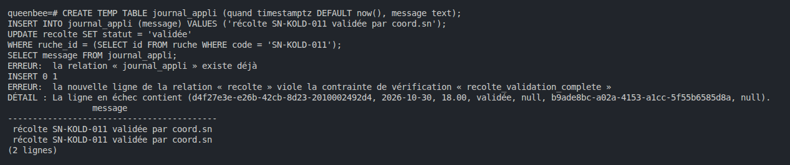
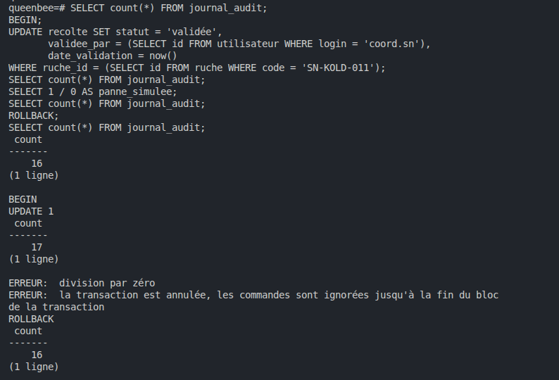
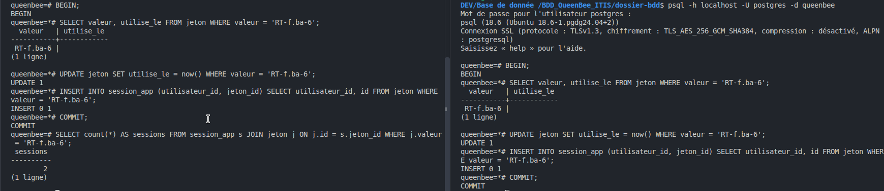
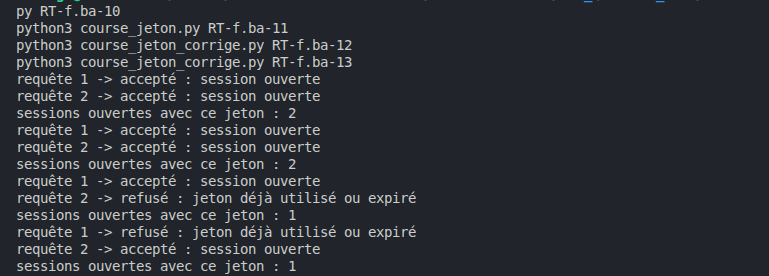
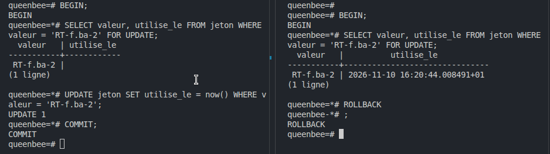
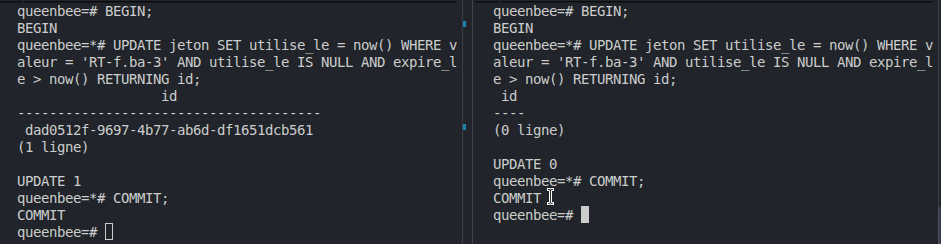
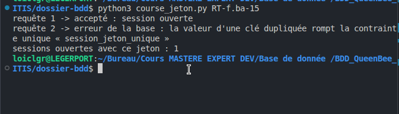
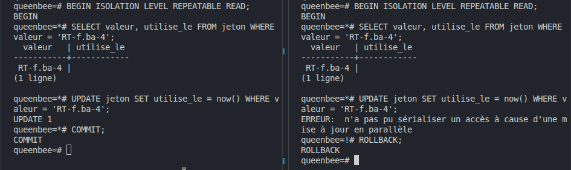

# Concurrence et transactions - Groupe Loïc, Alice et Victor

## Étape 9.1 · L'action et sa trace ensemble

### La trace qui ment

L'application écrit dans `journal_appli` que la récolte de SN-KOLD-011 est validée par coord.sn, puis fait
l'`UPDATE` sans `validee_par`. La base refuse (`recolte_validation_complete`), mais le journal de l'application
affirme quand même la validation : il ment.

### Avec une transaction

Avant : 16 lignes dans `journal_audit`. Dans la transaction, la validation complète passe et le trigger d'audit
écrit sa trace : 17 lignes. Après `SELECT 1 / 0`, la transaction est annulée et toute commande est refusée
jusqu'au `ROLLBACK`. Après le `ROLLBACK`, on revient à 16 : l'action et sa trace sont annulées ensemble.

Nous avons pris SN-KOLD-011 : la SN-CASA-011 de l'énoncé n'existe pas chez nous. La contrainte s'appelle chez nous
`recolte_validation_complete`, et la date de validation `date_validation`.

## Étape 9.2 · La course au jeton, dans deux terminaux

`jeton.sql` crée les tables `jeton` et `session_app`, et 30 jetons pour f.ba (`RT-f.ba-1` à `RT-f.ba-30`, valables
un jour). Course jouée avec `RT-f.ba-6`, deux terminaux psql :

| Temps | Terminal A | Terminal B |
|-------|------------|------------|
| T1 | `BEGIN` | |
| T2 | | `BEGIN` |
| T3 | SELECT : RT-f.ba-6, `utilise_le` vide | |
| T4 | | SELECT : RT-f.ba-6, `utilise_le` vide |
| T5 | `UPDATE 1` | |
| T6 | `INSERT 0 1` (session 1) | |
| T7 | `COMMIT` | |
| T8 | | `UPDATE 1` |
| T9 | | `INSERT 0 1` (session 2) |
| T10 | | `COMMIT` |
| T11 | 2 sessions avec RT-f.ba-6 | |

Les deux terminaux vérifient le jeton avant que l'un d'eux n'agisse : chacun le voit libre, et chacun ouvre une
session. Un jeton prévu pour servir une fois a servi deux fois (race condition).

Terminal A à gauche, terminal B à droite :

## Étape 9.3 · La course par un programme

- `course_jeton.py` (RT-f.ba-10 et -11) : 2 sessions à chaque fois.
- `course_jeton_corrige.py` (RT-f.ba-12 et -13) : un accepté, un refusé, 1 session.

La version vulnérable vérifie (`SELECT`), attend, puis agit : les deux requêtes voient le jeton libre et ouvrent
chacune une session. La version corrigée vérifie et agit dans un seul `UPDATE … WHERE utilise_le IS NULL … RETURNING` :
la seconde requête attend la fin de la première, puis ne trouve plus de jeton libre.

## Étape 9.4 · Les quatre corrections

### 1. `SELECT … FOR UPDATE` (RT-f.ba-2)

Le `SELECT` de A verrouille la ligne : B se fige sur son propre `SELECT … FOR UPDATE`. Dès que A fait `COMMIT`, B se
débloque et voit `utilise_le` rempli. B fait `ROLLBACK`.

### 2. `UPDATE … WHERE … RETURNING` (RT-f.ba-3)

A reçoit un `id`. B attend, puis PostgreSQL réévalue la condition `utilise_le IS NULL` : elle n'est plus vraie, B
reçoit 0 ligne.

### 3. `UNIQUE (jeton_id)` (RT-f.ba-15)

La contrainte est d'abord refusée : nos courses précédentes ont laissé des doublons. On garde la plus ancienne
session de chaque jeton, puis on la pose. Le programme vulnérable, relancé, n'ouvre plus qu'une session : l'autre
requête reçoit une erreur de clé dupliquée. La contrainte est ajoutée à la fin de `jeton.sql`.

### 4. `REPEATABLE READ` (RT-f.ba-4)

Les deux voient le jeton libre, mais l'`UPDATE` de B attend celui de A. Quand A valide, B échoue avec « n'a pas pu
sérialiser un accès à cause d'une mise à jour en parallèle » au lieu d'agir. B fait `ROLLBACK`.

### Comparaison

| Correction | Où agit-elle ? | Que voit la seconde requête ? | Avantage | Limite |
|------------|----------------|-------------------------------|----------|--------|
| `SELECT … FOR UPDATE` | dans la transaction : un verrou sur la ligne lue | elle attend, puis voit le jeton déjà utilisé | on garde le code en deux étapes | il faut l'écrire dans chaque programme, un oubli suffit |
| `UPDATE … WHERE … RETURNING` | dans une seule instruction : la condition est dans le `WHERE` | elle attend, puis 0 ligne | vérifier et agir ne font qu'un | ne protège que le code écrit ainsi |
| `UNIQUE (jeton_id)` | dans la base, quel que soit le programme | une erreur de clé dupliquée | protège même le code vulnérable | l'erreur arrive tard, le programme doit la gérer |
| `REPEATABLE READ` | le niveau d'isolation de la transaction | une erreur « n'a pas pu sérialiser un accès » | les requêtes ne changent pas | le programme doit annuler et réessayer |

### Le trigger du lab 6

Oui. Le trigger vérifie avec un `SELECT` (cette apicultrice a-t-elle déjà un formateur pour ce thème ?), puis laisse
passer. Deux insertions simultanées ne voient pas la ligne de l'autre, qui n'est pas encore validée : les deux
passent. Ce qui le protégerait, c'est une contrainte vérifiée par la base elle-même : recopier le thème dans
`suivi_formation` avec `UNIQUE (apicultrice_id, theme)`, ou passer ces transactions en `SERIALIZABLE`.
