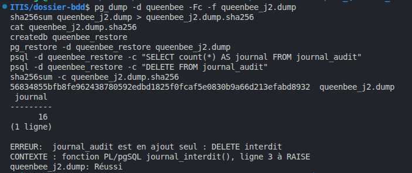

# Durabilité et sauvegarde - Groupe Loïc, Alice et Victor

## Étape 9.5

Réglages : `fsync = on`, `synchronous_commit = on`, `wal_level = replica`.

Sauvegarde avec `pg_dump`, empreinte SHA-256, restauration dans `queenbee_restore` : le journal restauré a le même
nombre de lignes (16), le `DELETE` y est toujours refusé, et `sha256sum -c` répond `queenbee_j2.dump: OK`.

**Avec `synchronous_commit = off`**, le `COMMIT` répond avant que le journal d'écriture (WAL) soit sur le disque. En
cas de panne juste après, les dernières transactions validées sont perdues, alors que l'application les croyait
enregistrées (une récolte validée, une ligne du journal d'audit).

**L'empreinte est gardée ailleurs que la sauvegarde** : si quelqu'un modifie la sauvegarde et a accès au même endroit,
il peut aussi recalculer l'empreinte. Rangée ailleurs, elle prouve que la sauvegarde n'a pas été modifiée.

**`pg_dump` ne sauvegarde pas les rôles** (`qb_apicultrice`, `f.ba`...) ni leurs mots de passe : ils sont communs à
tout le serveur. Il faut les sauvegarder à part avec `pg_dumpall --roles-only`, sinon la base restaurée sur un autre
serveur n'a plus ses comptes ni ses droits.

**Durabilité et sauvegarde** : la durabilité, c'est survivre à une panne (coupure de courant, plantage) : une
transaction validée est sur le disque. La sauvegarde, c'est survivre à la perte du disque, à une erreur (un `DELETE`
de trop) ou à un rançongiciel : une copie ailleurs, vérifiée, qu'on peut restaurer.
