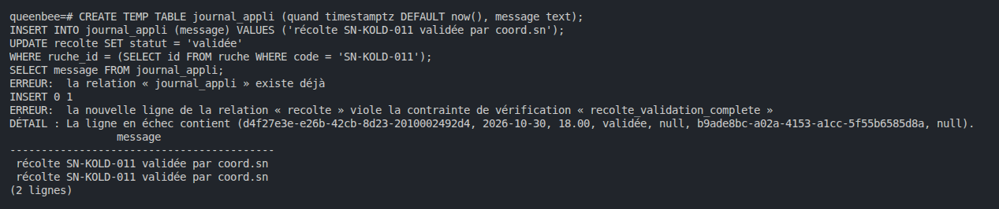
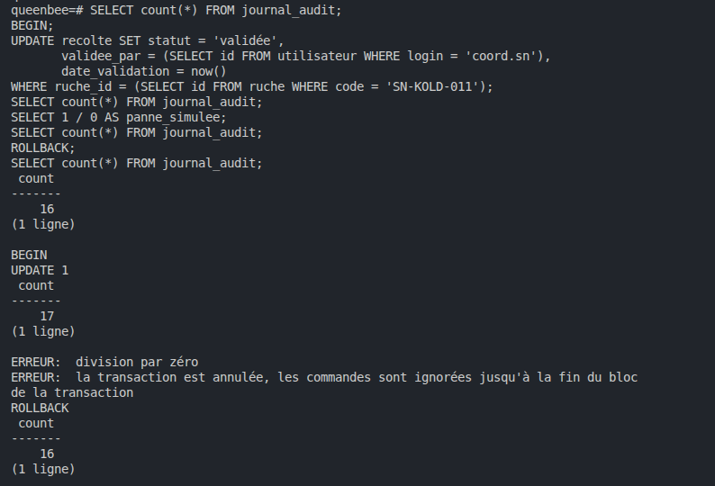
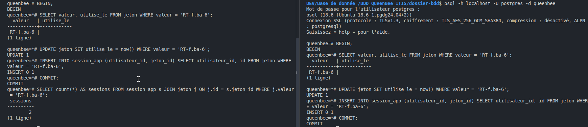

# Concurrence et transactions - Groupe Loïc, Alice et Victor

## Étape 9.1 · L'action et sa trace ensemble

### La trace qui ment

L'application écrit dans `journal_appli` que la récolte de SN-KOLD-011 est validée par coord.sn, puis fait
l'`UPDATE` sans `validee_par`. La base refuse (`recolte_validation_complete`), mais le journal de l'application
affirme quand même la validation : il ment.

### Avec une transaction

Avant : 16 lignes dans `journal_audit`. Dans la transaction, la validation complète passe et le trigger d'audit
écrit sa trace : 17 lignes. Après `SELECT 1 / 0`, la transaction est annulée et toute commande est refusée
jusqu'au `ROLLBACK`. Après le `ROLLBACK`, on revient à 16 : l'action et sa trace sont annulées ensemble.

Nous avons pris SN-KOLD-011 : la SN-CASA-011 de l'énoncé n'existe pas chez nous. La contrainte s'appelle chez nous
`recolte_validation_complete`, et la date de validation `date_validation`.

## Étape 9.2 · La course au jeton, dans deux terminaux

`jeton.sql` crée les tables `jeton` et `session_app`, et 30 jetons pour f.ba (`RT-f.ba-1` à `RT-f.ba-30`, valables
un jour). Course jouée avec `RT-f.ba-6`, deux terminaux psql :

| Temps | Terminal A | Terminal B |
|-------|------------|------------|
| T1 | `BEGIN` | |
| T2 | | `BEGIN` |
| T3 | SELECT : RT-f.ba-6, `utilise_le` vide | |
| T4 | | SELECT : RT-f.ba-6, `utilise_le` vide |
| T5 | `UPDATE 1` | |
| T6 | `INSERT 0 1` (session 1) | |
| T7 | `COMMIT` | |
| T8 | | `UPDATE 1` |
| T9 | | `INSERT 0 1` (session 2) |
| T10 | | `COMMIT` |
| T11 | 2 sessions avec RT-f.ba-6 | |

Les deux terminaux vérifient le jeton avant que l'un d'eux n'agisse : chacun le voit libre, et chacun ouvre une
session. Un jeton prévu pour servir une fois a servi deux fois (race condition).

Terminal A à gauche, terminal B à droite :

## Étape 9.3 · La course par un programme

- `course_jeton.py` (RT-f.ba-10 et -11) : 2 sessions à chaque fois.
- `course_jeton_corrige.py` (RT-f.ba-12 et -13) : un accepté, un refusé, 1 session.

<!-- IMG : course_jeton.py : 2 sessions -->
<!--  -->

<!-- IMG : course_jeton_corrige.py : 1 session -->
<!--  -->

## Étape 9.4 · Les quatre corrections

<!-- IMG : correction 1, FOR UPDATE (RT-f.ba-2) -->
<!--  -->

<!-- IMG : correction 2, UPDATE … RETURNING (RT-f.ba-3) -->
<!--  -->

<!-- IMG : correction 3, UNIQUE (refus, nettoyage, puis RT-f.ba-14) -->
<!--  -->

<!-- IMG : correction 4, REPEATABLE READ (RT-f.ba-4) -->
<!--  -->

| Correction | Où agit-elle ? | Que voit la seconde requête ? | Avantage | Limite |
|------------|----------------|-------------------------------|----------|--------|
| `SELECT … FOR UPDATE` | ___ | ___ | ___ | ___ |
| `UPDATE … WHERE … RETURNING` | ___ | ___ | ___ | ___ |
| `UNIQUE (jeton_id)` | ___ | ___ | ___ | ___ |
| `REPEATABLE READ` | ___ | ___ | ___ | ___ |

Le trigger du lab 6 est aussi un « vérifier, puis agir ». Deux insertions simultanées peuvent-elles le contourner ?
Quelle correction le protégerait ? _À compléter._
