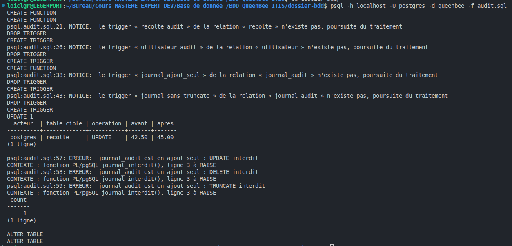
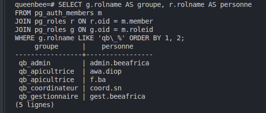
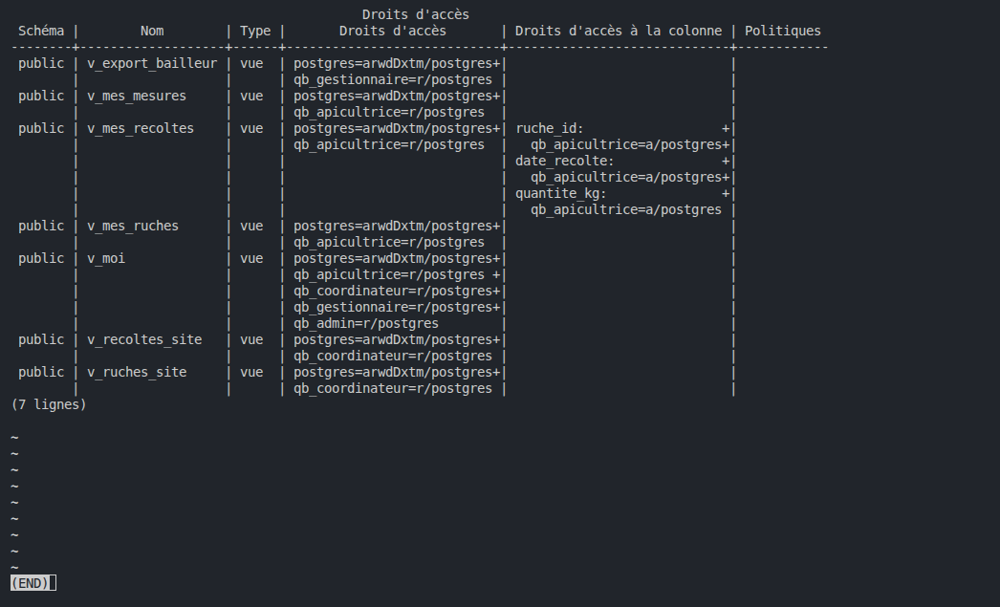
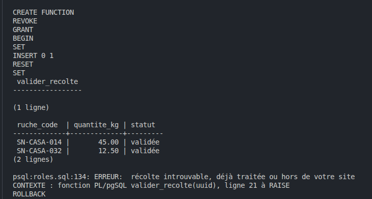
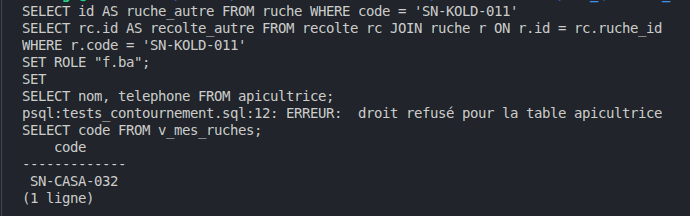
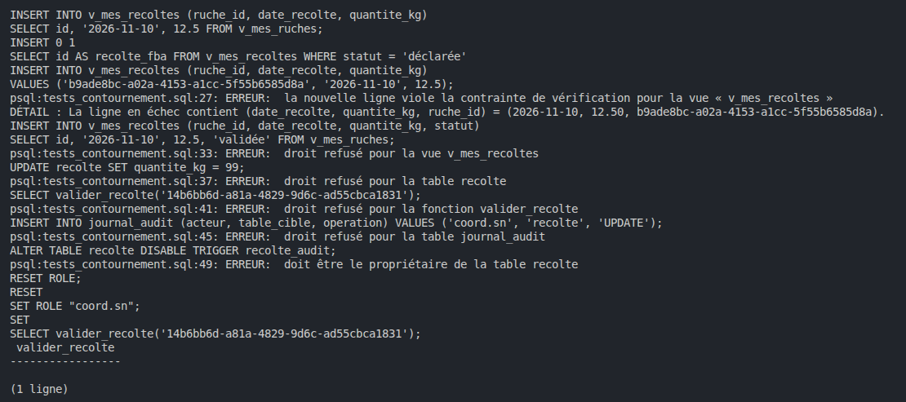
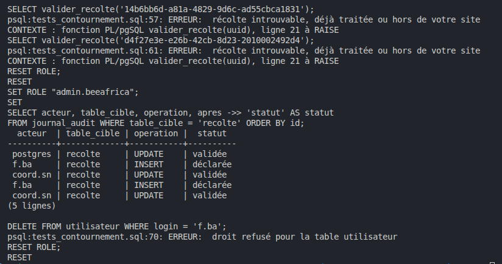

# Matrice des droits

## Étape 8.1 · Que se passe-t-il quand on supprime ?

| Clé | Action | Pourquoi |
|-----|--------|----------|
| les deux clés de `adhesion` | `CASCADE` | lien sans valeur propre |
| `ruche_id` de `mesure`, `inspection`, `recolte`, `alerte` | `RESTRICT` | ce sont des preuves, on ne doit pas les effacer en supprimant une ruche |

Test : `DELETE FROM ruche WHERE code = 'SN-CASA-099';` est refusé par `mesure_ruche_fk`. 
Avec `CASCADE` (dans un `BEGIN` / `ROLLBACK`), la même commande efface la ruche et environ 4 368 mesures sans message.

 

 

## Étape 8.2 · Refuser les valeurs impossibles

`check.sql` ajoute six contraintes `CHECK` (batterie, humidité, poids, rôle, statut d'alerte, statut de récolte).

 

## Étape 8.3 · Limite du journal d'audit

Le propriétaire (`postgres`) peut désactiver le trigger du journal (`ALTER TABLE journal_audit DISABLE TRIGGER journal_ajout_seul;`),
puis le réactiver. C'est pourquoi le journal doit aussi être copié hors de la base (vers le SIEM du cahier des charges).

## Étape 8.4 · La matrice (à remplir avant d'écrire le moindre GRANT)

| Objet | apicultrice | coordinateur | gestionnaire | admin |
|-------|-------------|--------------|--------------|-------|
| ses ruches et leurs mesures | lire (`v_mes_ruches`, `v_mes_mesures`) | non | non | non |
| déclarer une récolte | sur ses ruches (`v_mes_recoltes`) | non | non | non |
| valider une récolte (UC-C02) | non | sur son site (`valider_recolte`, 8.5) | non | non |
| ruches et téléphones de son site | non | lire (`v_ruches_site`, `v_recoltes_site`) | non | non |
| synthèse et export (UC-G01, UC-G02) | non | non | lire | non |
| comptes utilisateurs (UC-AD01) | son compte (`v_moi`) | son compte | son compte | lire, créer, modifier (pas supprimer) |
| journal d'audit | non | non | non | lire |

Nos logins ont été renommés pour porter le nom du rôle PostgreSQL :
 - `f.ba` = Fatou Sow,`awa.diop` = Awa Diop,
, -  `coord.sn` = coordin
 - ateur de SN-CASA, `admin.beeafrica` = 
 - l'administrateur, `gest.beeafrica` ajo
 - uté.
 

Les deux Aminata Diop deviennent `aminata.diop.casa` et `aminata.diop.kold` : `login` est maintenant `UNIQUE`.

## Étape 8.5 · `valider_recolte`

Le coordinateur ne reçoit pas `UPDATE` sur `recolte` : il pourrait changer les quantités. Il passe par`valider_recolte`, 
une fonction `SECURITY DEFINER` qui ne valide qu'une récolte `déclarée` d'une ruche de son site,
et qui est fermée à tous sauf `qb_coordinateur`. Revalider une récolte, ou en valider une d'un autre site, est refusé.

## Étape 8.6 · Tests de contournement

| N° | Qui | Tentative | Attendu | Résultat |
|----|-----|-----------|---------|----------|
| 1 | f.ba | lire `apicultrice` directement | refusé | refusé : droit refusé pour la table apicultrice |
| 2 | f.ba | lire `v_mes_ruches` | ses ruches seulement | SN-CASA-032 seulement |
| 3 | f.ba | déclarer une récolte sur sa ruche | accepté | accepté : `INSERT 0 1` |
| 4 | f.ba | déclarer une récolte sur la ruche d'une autre | refusé (check option) | refusé : viole la contrainte de vérification de la vue |
| 5 | f.ba | déclarer une récolte avec `statut = 'validée'` | refusé | refusé : pas de droit sur la colonne `statut` |
| 6 | f.ba | `UPDATE recolte SET quantite_kg = 99` | refusé | refusé : droit refusé pour la table recolte |
| 7 | f.ba | appeler `valider_recolte(…)` | refusé | refusé : droit refusé pour la fonction |
| 8 | f.ba | écrire une fausse ligne dans `journal_audit` | refusé | refusé : droit refusé pour la table journal_audit |
| 9 | f.ba | `DISABLE TRIGGER recolte_audit` | refusé | refusé : doit être le propriétaire de la table |
| 10 | coord.sn | valider la récolte du test 3, puis la revalider | accepté, puis refusé | accepté, puis « récolte introuvable, déjà traitée ou hors de votre site » |
| 11 | coord.sn | valider une récolte d'un autre site | refusé | refusé (récolte de SN-KOLD-011 : CM-BAFO n'a pas de récolte chez nous) |
| 12 | admin.beeafrica | lire le journal ; supprimer un utilisateur | lu ; refusé | lu ; refusé : droit refusé pour la table utilisateur |

Tous les tests donnent le résultat attendu. Le journal lu par l'admin nomme les vrais acteurs, `f.ba | recolte | INSERT`
et `coord.sn | recolte | UPDATE`, même quand la validation passe par une fonction `SECURITY DEFINER`. Les tests ont été
lancés deux fois, d'où deux paires de lignes : le journal garde tout.

