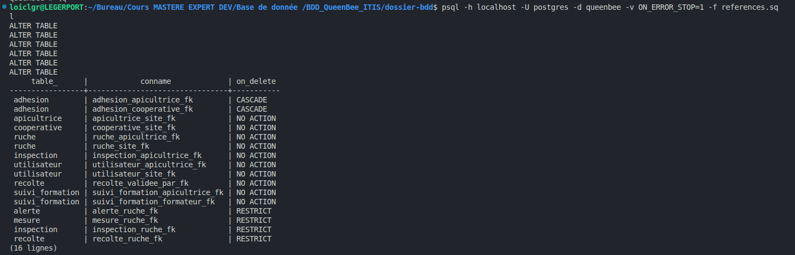
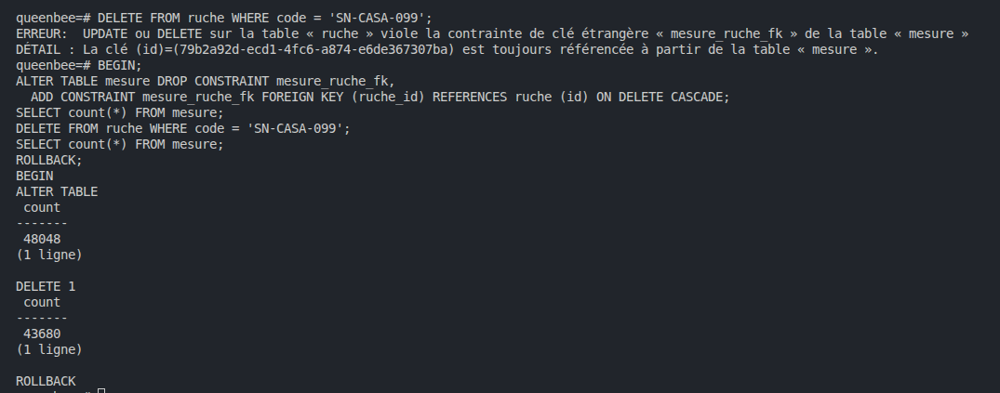
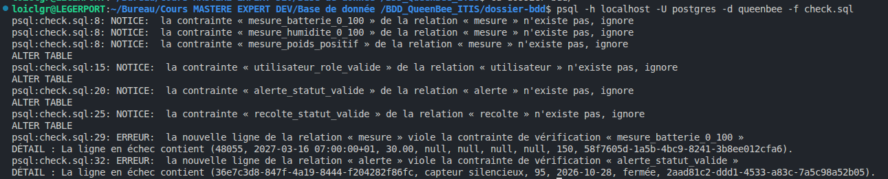

# Matrice des droits

## Étape 8.1 · Que se passe-t-il quand on supprime ?

| Clé | Action | Pourquoi |
|-----|--------|----------|
| les deux clés de `adhesion` | `CASCADE` | lien sans valeur propre |
| `ruche_id` de `mesure`, `inspection`, `recolte`, `alerte` | `RESTRICT` | ce sont des preuves, on ne doit pas les effacer en supprimant une ruche |

Test : `DELETE FROM ruche WHERE code = 'CI-MAN-012';` est refusé par `mesure_ruche_fk`. 
Avec `CASCADE` (dans un `BEGIN` / `ROLLBACK`), la même commande efface la ruche et environ 4 368 mesures sans message.

 

 

## Étape 8.2 · Refuser les valeurs impossibles

`check.sql` ajoute six contraintes `CHECK` (batterie, humidité, poids, rôle, statut d'alerte, statut de récolte).

 

## Étape 8.3 · Limite du journal d'audit

Le propriétaire (`postgres`) peut désactiver le trigger du journal (`ALTER TABLE journal_audit DISABLE TRIGGER journal_ajout_seul;`),
puis le réactiver. C'est pourquoi le journal doit aussi être copié hors de la base (vers le SIEM du cahier des charges).

<!-- IMG : UPDATE de la récolte puis lecture du journal (postgres | recolte | UPDATE | 12.5 | 14.0) -->
<!--  -->

<!-- IMG : UPDATE, DELETE, TRUNCATE sur le journal : trois refus -->
<!--  -->

## Étape 8.4 · La matrice (à remplir avant d'écrire le moindre GRANT)

| Objet | apicultrice | coordinateur | gestionnaire | admin |
|-------|-------------|--------------|--------------|-------|
| ses ruches et leurs mesures | lire | ___ | ___ | ___ |
| déclarer une récolte | sur ses ruches | ___ | ___ | ___ |
| valider une récolte (UC-C02) | non | ___ | ___ | ___ |
| ruches et téléphones de son site | ___ | ___ | ___ | ___ |
| synthèse et export (UC-G01, UC-G02) | ___ | ___ | ___ | ___ |
| comptes utilisateurs (UC-AD01) | ___ | ___ | ___ | ___ |
| journal d'audit | ___ | ___ | ___ | lire |

<!-- IMG : les groupes et les personnes (requête LIKE 'qb\_%', cinq lignes) -->
<!--  -->

<!-- IMG : droits sur les vues (\dp) -->
<!--  -->

## Étape 8.5 · `valider_recolte`

_À compléter si besoin._

<!-- IMG : validation par coord.sn, puis message d'erreur -->
<!--  -->

## Étape 8.6 · Tests de contournement

| N° | Qui | Tentative | Attendu | Résultat |
|----|-----|-----------|---------|----------|
| 1 | f.ba | lire `apicultrice` directement | refusé | ___ |
| 2 | f.ba | lire `v_mes_ruches` | ses ruches seulement | ___ |
| 3 | f.ba | déclarer une récolte sur sa ruche | accepté | ___ |
| 4 | f.ba | déclarer une récolte sur la ruche d'une autre | refusé (check option) | ___ |
| 5 | f.ba | déclarer une récolte avec `statut = 'validee'` | refusé | ___ |
| 6 | f.ba | `UPDATE recolte SET volume_kg = 99` | refusé | ___ |
| 7 | f.ba | appeler `valider_recolte(…)` | refusé | ___ |
| 8 | f.ba | écrire une fausse ligne dans `journal_audit` | refusé | ___ |
| 9 | f.ba | `DISABLE TRIGGER recolte_audit` | refusé | ___ |
| 10 | coord.sn | valider la récolte du test 3, puis la revalider | accepté, puis refusé | ___ |
| 11 | coord.sn | valider une récolte d'un autre site (CM-BAF) | refusé | ___ |
| 12 | admin.beeafrica | lire le journal ; supprimer un utilisateur | lu ; refusé | ___ |

<!-- IMG : tests 1 à 4 -->
<!--  -->

<!-- IMG : tests 5 à 9 -->
<!--  -->

<!-- IMG : tests 10 à 12 -->
<!--  -->
