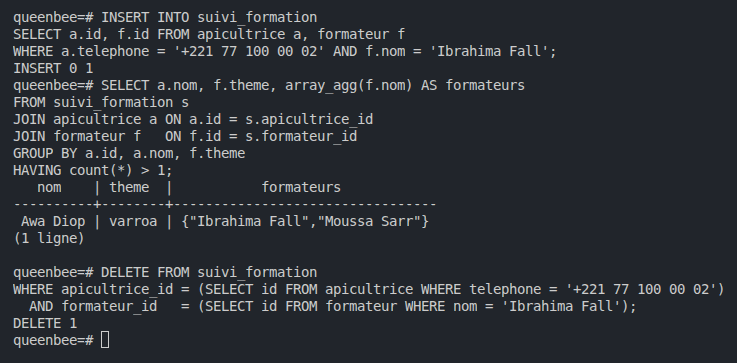
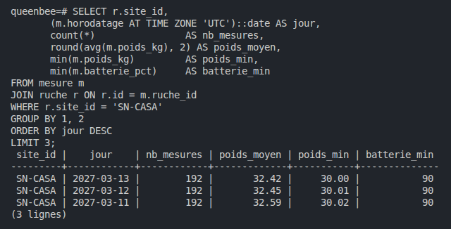
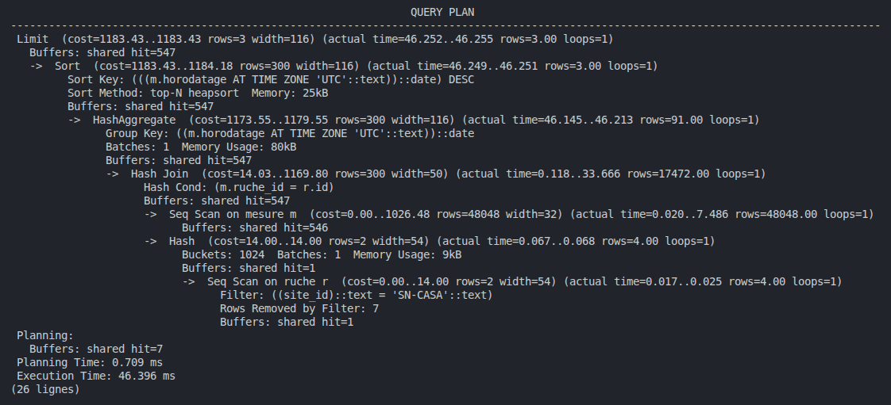
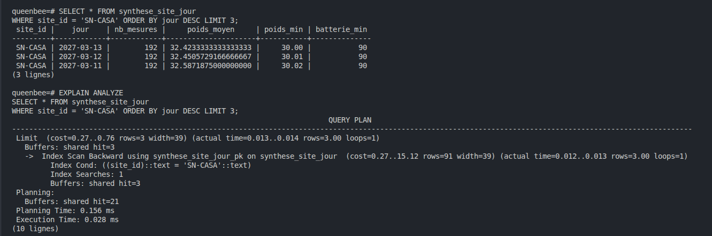
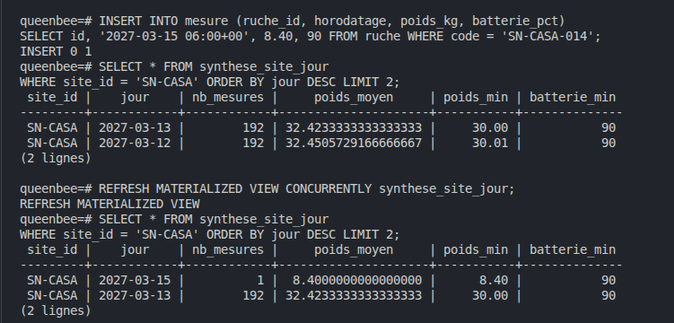

# Normalisation J2

## Étape 6.1 · Analyser la table reçue (`formation_plat`)

### Dépendances

- `(telephone, theme) -> formateur` : pour un thème, une apicultrice n'a qu'un formateur.
- `formateur -> theme` : un formateur n'enseigne qu'un thème.

Les trois tests `GROUP BY … HAVING` renvoient 0 ligne : les données respectent ces règles.


### Clés candidates

- `(telephone, theme)`
- `(telephone, formateur)`

### 3NF ? BCNF ?

- **3NF : oui**, car `theme` fait partie d'une clé candidate.
- **BCNF : non**, car `formateur -> theme` part de `formateur`, qui n'est pas une clé.

### Anomalie

Dans une transaction annulée (`BEGIN` … `ROLLBACK`), On a passé Moussa Sarr en `capteurs` sur la ligne
`+221 77 100 00 02`. Résultat : `Moussa Sarr | {capteurs,varroa}`.

La table accepte la modification sans erreur : Moussa Sarr enseigne deux thèmes, et la règle
`formateur -> theme` est violée.


## Étape 6.2 · Découper, et prouver qu'on n'a rien perdu

### Le mauvais découpage

On découpe en `p1 (telephone, theme)` et `p2 (theme, formateur)`. La colonne commune `theme` n'est la clé
d'aucun des deux morceaux : un thème a plusieurs formateurs. La jointure donne 16 lignes au lieu de 8, dont
8 inventées. Par exemple, Awa Diop (`+221 77 100 00 02`, Fatou Ba dans l'énoncé) serait suivie par trois
formateurs varroa.


### Le bon découpage (BCNF)

- `formateur (id, nom UNIQUE, theme)` : la contrainte `UNIQUE` sur `nom` garantit `formateur -> theme`
  (un nom = une seule ligne = un seul thème). Le `CHECK` limite `theme` à varroa, recolte, capteurs.
- `suivi_formation (apicultrice_id, formateur_id)`, clé primaire sur les deux colonnes.

`suivi_formation` pointe vers `apicultrice(id)` et non vers le téléphone, pour ne pas recopier le téléphone : s'il
change, on le modifie à un seul endroit (dans `apicultrice`).

Preuve : 5 formateurs, 8 suivis, et la double comparaison `EXCEPT` avec la table d'origine renvoie 0 ligne dans
les deux sens : rien de perdu, rien d'inventé.


## Étape 6.3 · La règle perdue, et le trigger qui la rétablit

### La règle perdue

Après le découpage, plus aucune table ne contient à la fois l'apicultrice et le thème : on a pu inscrire Awa Diop
(Fatou Ba dans l'énoncé) chez Ibrahima Fall (varroa) alors qu'elle a déjà Moussa Sarr.
Résultat : `Awa Diop | varroa | {"Ibrahima Fall","Moussa Sarr"}`.



### Le trigger

`suivi_un_formateur_par_theme()` et `suivi_formation_df` refusent un second formateur pour le même thème.

- Chez Ibrahima Fall (varroa) : refusé, `DF violée : cette apicultrice a déjà un formateur pour ce thème`.
- Chez Khady Ndiaye (récolte, thème nouveau) : accepté, `INSERT 0 1`.


### Pour aller plus loin : changer le thème d'un formateur

Le trigger ne regarde que `suivi_formation`. Si on change le thème d'un formateur directement dans `formateur`,
il ne se déclenche pas. En passant Moussa Sarr en `recolte`, Aminata Diop (Casamance) se retrouve avec deux
formateurs récolte (Khady Ndiaye et Moussa Sarr), et la base accepte (`UPDATE 1`).

On a donc ajouté un deuxième trigger, `formateur_theme_df`, sur `UPDATE OF theme` de `formateur`. Il refuse le
changement si une des apicultrices de ce formateur a déjà un autre formateur pour le nouveau thème :
`DF violée : une apicultrice de ce formateur a déjà un formateur pour ce thème`.


## Étape 6.4 · Relire tout le schéma

### Revue BCNF

| Table | Dépendances | Partie gauche = super-clé ? | BCNF ? |
|---|---|---|---|
| site | id -> nom, pays | oui | oui |
| apicultrice | id -> nom, telephone, site_id | oui | oui |
| cooperative | id -> nom, site_id | oui | oui |
| adhesion | (apicultrice_id, cooperative_id) -> date_adhesion | oui | oui |
| ruche | id -> tout ; code -> tout ; apicultrice_id -> site_id | non pour apicultrice_id | non (voir plus bas) |
| alerte | id -> tout | oui | oui |
| mesure | id -> tout ; (ruche_id, horodatage) -> tout | oui | oui |
| inspection | id -> tout | oui | oui |
| utilisateur | id -> tout ; apicultrice_id -> tout ; login -> tout | oui | oui, mais site_id recopie celui de l'apicultrice (voir plus bas) |
| recolte | id -> tout | oui | oui |
| formateur | id -> tout ; nom -> tout | oui | oui |
| suivi_formation | (apicultrice_id, formateur_id), aucune autre colonne | oui | oui |
| formation_plat | formateur -> theme | **non** | **non** (3NF seulement, voir 6.1) |


Chaque apicultrice n'a de ruches que sur son site.

Le cahier des charges dit qu'une apicultrice est rattachée à un site et qu'une ruche appartient à une apicultrice. 
Pour nous c'est une règle métier : 
- chaque site a son coordinateur
- si une apicultrice posait une ruche sur un autre site, son coordinateur ne la verrait plus.

Du coup, `ruche.site_id` recopie le site de l'apicultrice. Dans `ruche`, on a `apicultrice_id -> site_id`,
et `apicultrice_id` n'est pas une clé de la table : `ruche` n'est donc pas en BCNF. 
Si quelqu'un change le site d'une ruche sans changer celui de l'apicultrice, la base l'accepte sans rien dire.

Aujourd'hui, rien ne garantit cette cohérence dans notre schéma. Les deux `site_id` sont des clés étrangères
séparées vers `site`. Le test 7 de `tests_schema.sql` permet de voir s'il y a un écart, mais il ne bloque rien.

Notre solution : garder `ruche.site_id`, mais obliger la base à vérifier qu'il est le même que celui de
l'apicultrice, avec une clé étrangère sur les deux colonnes.

```sql
ALTER TABLE apicultrice ADD CONSTRAINT apicultrice_id_site_unique UNIQUE (id, site_id);
ALTER TABLE ruche ADD CONSTRAINT ruche_apicultrice_site_fk
  FOREIGN KEY (apicultrice_id, site_id) REFERENCES apicultrice (id, site_id) ON UPDATE CASCADE;
```

On l'a testé dans une transaction annulée : déplacer une seule ruche sur un autre site est refusé, et si on
change le site d'une apicultrice, ses ruches suivent grâce au `ON UPDATE CASCADE`. L'autre solution serait de
supprimer `ruche.site_id` et de passer par l'apicultrice pour connaître le site, mais il faudrait reprendre toutes
les requêtes qui utilisent `ruche.site_id`.

### utilisateur.site_id, une autre copie

Pour un compte d'apicultrice, `utilisateur.site_id` recopie aussi `apicultrice.site_id`. La table reste en BCNF
(`apicultrice_id` est `UNIQUE`, donc c'est une clé), mais c'est la même information écrite à deux endroits : si
l'apicultrice change de site, son compte garde l'ancien. Pour un coordinateur, en revanche, `site_id` est la
seule information sur son site, donc on ne peut pas supprimer la colonne. Aujourd'hui les deux sont identiques
(0 ligne, test à la fin de `formation.sql`). La même clé étrangère sur `(apicultrice_id, site_id)` vers
`apicultrice (id, site_id)` règle le problème : elle ne s'applique qu'aux comptes d'apicultrice, puisque pour les
autres `apicultrice_id` est vide.


## Étape 7.1 · Mesurer avant de copier

`volume.sql` : 90 jours de mesures par ruche, une toutes les 30 minutes (`INSERT 0 47520`).



Tableau de bord du gestionnaire (UC-G01), site SN-CASA,
`EXPLAIN ANALYZE` : 192 mesures par jour, Execution Time de 46.396 ms (`Seq Scan on mesure` : toute la table est lue).




## Étape 7.2 · La synthèse, et son prix

Vue matérialisée `synthese_site_jour`.

- Temps sur la table `mesure` : 46.396 ms
- Temps sur la vue : 0.028 ms



### Le vol (UC-CY04)

Le 15 mars à 6 h, SN-CASA-014 passe à 8,4 kg (la SN-CASA-011 de l'énoncé n'existe pas chez nous). Le 15 mars n'apparaît dans la vue qu'après le `REFRESH`.



Si la vue n'est rafraîchie que la nuit, le vol reste invisible jusqu'au prochain rafraîchissement, soit plusieurs heures (jusqu'à 24 h au pire). Il faut donc détecter un vol dans les mesures brutes, pas dans la synthèse.


## Étape 7.3 · L'export pour le bailleur

### Casser un haché simple

Le haché `sha256` du téléphone d'Awa Diop (Fatou Ba dans l'énoncé) se casse en essayant tous les numéros qui
commencent par `+221 77 1` : un million de possibilités. On retrouve `+221 77 100 00 02` en 2,1 s. Un simple haché
ne protège donc pas un téléphone.

### Le bon export

`cle_pseudonymisation` contient une clé tirée au hasard, fermée à tout le monde (`REVOKE ALL ... FROM PUBLIC`). La
vue `v_export_bailleur` donne un pseudonyme calculé avec `hmac()` sur l'id de l'apicultrice : sans la clé, on ne
peut pas le recalculer. Résultat : 8 lignes pour 11 ruches, et la vérification renvoie `f`, la clé n'est pas
écrite dans la définition de la vue.

Attention, dans notre schéma le statut s'écrit `validée` avec un accent, pas `validee` comme dans l'énoncé : avec
`validee`, le total des récoltes serait toujours vide.

### Les colonnes retirées

- le nom et le téléphone de l'apicultrice : ils permettent de la reconnaître directement ;
- l'id de l'apicultrice : il est remplacé par le pseudonyme, sinon on pourrait faire le lien avec la base ;
- le code de la ruche : il est unique, donc il permettrait de remonter à la ruche puis à l'apicultrice ;
- la position exacte : arrondie à 0,1 degré (environ 11 km), sinon on pourrait retrouver l'endroit précis des
  ruches, et donc la personne ou un rucher à voler ;
- les mesures, inspections et alertes : le bailleur n'en a pas besoin, on n'exporte que le total des récoltes
  validées.

Le pseudonyme reste une donnée personnelle au sens du RGPD : celui qui a la clé peut retrouver l'apicultrice.

Toutes les requêtes des labs 6 et 7, avec leur résultat en commentaire, sont à la fin de `formation.sql`
(lab 6), `volume.sql` (7.1) et `denormalisation.sql` (7.2 et 7.3).
