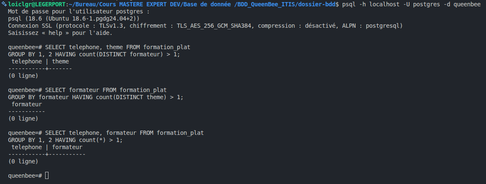
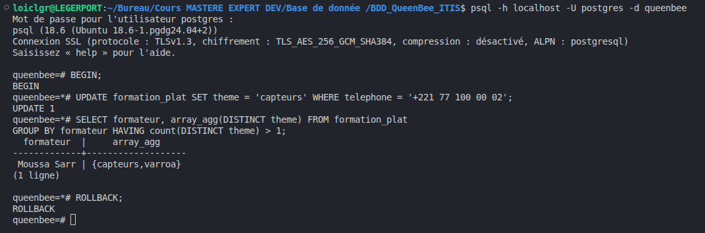
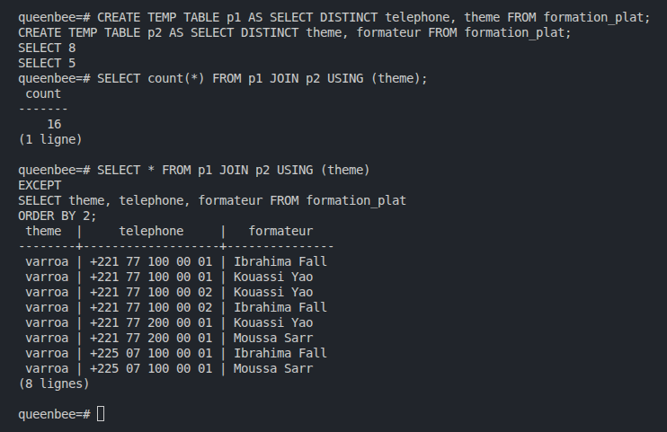
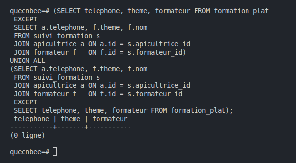
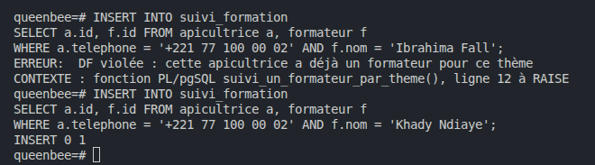
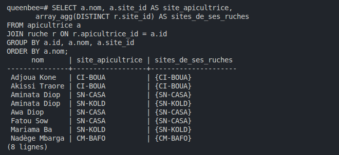

# Normalisation J2

## Étape 6.1 · Analyser la table reçue (`formation_plat`)

### Dépendances

- `(telephone, theme) -> formateur` : pour un thème, une apicultrice n'a qu'un formateur.
- `formateur -> theme` : un formateur n'enseigne qu'un thème.

Les trois tests `GROUP BY … HAVING` renvoient 0 ligne : les données respectent ces règles.

### Clés candidates

- `(telephone, theme)`
- `(telephone, formateur)`

### 3NF ? BCNF ?

- **3NF : oui**, car `theme` fait partie d'une clé candidate.
- **BCNF : non**, car `formateur -> theme` part de `formateur`, qui n'est pas une clé.

### Anomalie

Dans une transaction annulée (`BEGIN` … `ROLLBACK`), On a passé Moussa Sarr en `capteurs` sur la ligne
`+221 77 100 00 02`. Résultat : `Moussa Sarr | {capteurs,varroa}`.

La table accepte la modification sans erreur : Moussa Sarr enseigne deux thèmes, et la règle
`formateur -> theme` est violée.

## Étape 6.2 · Découper, et prouver qu'on n'a rien perdu

### Le mauvais découpage

On découpe en `p1 (telephone, theme)` et `p2 (theme, formateur)`. La colonne commune `theme` n'est la clé
d'aucun des deux morceaux : un thème a plusieurs formateurs. La jointure donne 16 lignes au lieu de 8, dont
8 inventées. Par exemple, Fatou Ba (`+221 77 100 00 02`) serait suivie par trois formateurs varroa.

### Le bon découpage (BCNF)

- `formateur (id, nom UNIQUE, theme)` : la contrainte `UNIQUE` sur `nom` garantit `formateur -> theme`
  (un nom = une seule ligne = un seul thème). Le `CHECK` limite `theme` à varroa, recolte, capteurs.
- `suivi_formation (apicultrice_id, formateur_id)`, clé primaire sur les deux colonnes.

`suivi_formation` pointe vers `apicultrice(id)` et non vers le téléphone, pour ne pas recopier le téléphone : s'il
change, on le modifie à un seul endroit (dans `apicultrice`).

Preuve : 5 formateurs, 8 suivis, et la double comparaison `EXCEPT` avec la table d'origine renvoie 0 ligne dans
les deux sens : rien de perdu, rien d'inventé.

## Étape 6.3 · La règle perdue, et le trigger qui la rétablit

### La règle perdue

Après le découpage, plus aucune table ne contient à la fois l'apicultrice et le thème : on a pu inscrire Fatou Ba
chez Ibrahima Fall (varroa) alors qu'elle a déjà Moussa Sarr. Résultat : `Fatou Ba | varroa | {"Moussa Sarr","Ibrahima Fall"}`.

<!-- IMG : INSERT 0 1 puis la requête qui montre les deux formateurs varroa -->
<!--  -->

### Le trigger

`suivi_un_formateur_par_theme()` et `suivi_formation_df` refusent un second formateur pour le même thème.

- Chez Ibrahima Fall (varroa) : refusé, `DF violée : cette apicultrice a déjà un formateur pour ce thème`.
- Chez Khady Ndiaye (récolte, thème nouveau) : accepté, `INSERT 0 1`.

<!-- IMG : l'insertion refusée et l'insertion acceptée -->
<!--  -->

### Pour aller plus loin (facultatif)

_À compléter : avec `UNIQUE (apicultrice_id, theme)` et la clé étrangère composée, est-ce encore en BCNF ?_

## Étape 6.4 · Relire tout le schéma

### Revue BCNF

| Table | Dépendances | Partie gauche = super-clé ? | BCNF ? |
|-------|-------------|-----------------------------|--------|
| `formateur` | _à compléter_ | | |
| `suivi_formation` | _à compléter_ | | |

<!-- IMG : requête apicultrice.site_id / ruche.site_id -->
<!--  -->

Règle métier ou coïncidence ? _À compléter_ (et ce qui garantit la cohérence dans le schéma).

## Étape 7.1 · Mesurer avant de copier

`volume.sql` : 90 jours de mesures par ruche, une toutes les 30 minutes (`INSERT 0 47520`).

<!-- IMG : INSERT 0 47520 -->
<!--  -->

Tableau de bord du gestionnaire (UC-G01), site SN-CASA, `EXPLAIN ANALYZE` : 192 mesures par jour,
Execution Time de l'ordre de 10 ms : _à compléter avec le temps mesuré_.

<!-- IMG : EXPLAIN ANALYZE du tableau de bord (avant la vue) -->
<!--  -->

## Étape 7.2 · La synthèse, et son prix

Vue matérialisée `synthese_site_jour`.

- Temps sur la table `mesure` : _à compléter_ ms
- Temps sur la vue : _à compléter_ ms (attendu moins de 0,2 ms)

<!-- IMG : EXPLAIN ANALYZE du tableau de bord dans la vue -->
<!--  -->

### Le vol (UC-CY04)

Le 15 mars à 6 h, SN-CASA-011 passe à 8,4 kg. Le 15 mars n'apparaît dans la vue qu'après le `REFRESH`.

<!-- IMG : insertion, vue avant REFRESH, REFRESH, vue après -->
<!--  -->

Si la vue n'est rafraîchie que la nuit, le vol reste invisible jusqu'à : _à compléter_.
